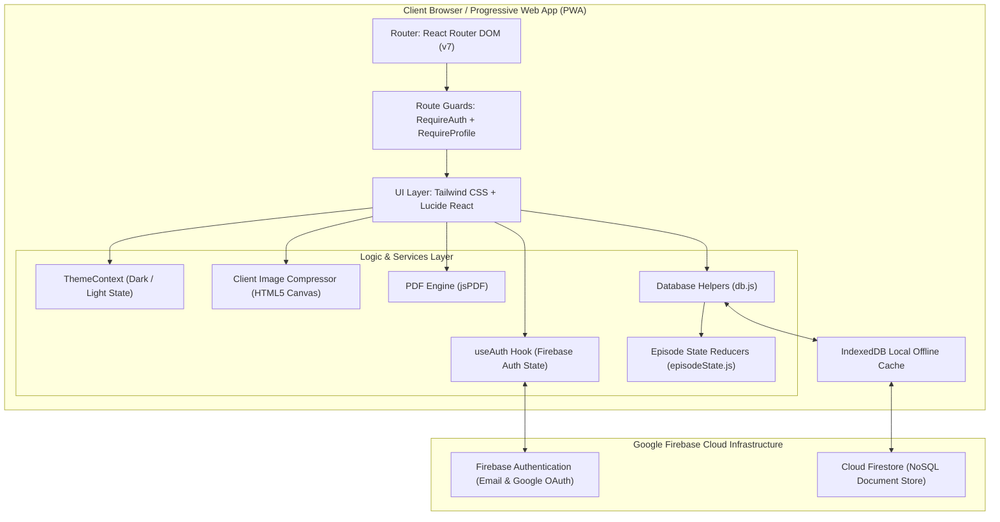

<div align="center">

# MedTrack

**A privacy-conscious, client-driven personal and family health episode tracker with longitudinal continuation timelines, vitals trend analytics, and exportable clinical dossiers.**

[](https://react.dev/)
[](https://vitejs.dev/)
[](https://firebase.google.com/)
[](https://tailwindcss.com/)
[](https://recharts.org/)
[](https://github.com/parallax/jsPDF)
[](https://vite-pwa-org.netlify.app/)
[](#16-license)

[Features](#4-key-features) • [Architecture](#7-system-architecture) • [Getting Started](#9-installation-and-setup) • [Environment Variables](#10-environment-variables) • [Security & Privacy](#12-security-and-privacy) • [Roadmap](#13-roadmap)

</div>

---

## Table of Contents

- [1. Project Header](#1-project-header)
- [2. Overview](#2-overview)
- [3. The Problem](#3-the-problem)
- [4. Key Features](#4-key-features)
- [5. Screenshots and Visual Assets](#5-screenshots-and-visual-assets)
- [6. Technology Stack](#6-technology-stack)
- [7. System Architecture](#7-system-architecture)
- [8. Project Structure](#8-project-structure)
- [9. Installation and Setup](#9-installation-and-setup)
- [10. Environment Variables](#10-environment-variables)
- [11. Usage Guide](#11-usage-guide)
- [12. Security and Privacy](#12-security-and-privacy)
- [13. Roadmap](#13-roadmap)
- [14. Contributing](#14-contributing)
- [15. Issues and Bug Reports](#15-issues-and-bug-reports)
- [16. License](#16-license)
- [17. Acknowledgements](#17-acknowledgements)

---

## 1. Project Header

MedTrack is a modern web application engineered to bridge the communication gap between individuals and healthcare providers. It structures acute and chronic illness tracking into discrete, manageable "episodes" that chronologically document symptoms, clinical encounters, diagnostic observations, vitals trajectories, and prescription records.

---

## 2. Overview

Managing healthcare records remains a largely analog, fragmented experience. Patients visit general practitioners, clinics, or specialists, receiving paper slips, handwritten instructions, and physical prescriptions. By the time a follow-up consultation occurs or a specialist asks for medical history, the exact sequence of symptom progression, previous antibiotic regimens, and vital readings are often forgotten or misplaced.

**MedTrack** transforms unstructured health incidents into clean, episodic medical timelines. Rather than treating health entries as static notes or disassociated lists, MedTrack models illness as an evolving lifecycle:

1. **Initial Onset**: Logging the primary complaint, baseline symptoms, and initial medication source.
2. **Continuation Checkpoints**: Progressively recording which symptoms resolved, what new symptoms surfaced, doctor visit summaries, and vitals updates (Body Temperature, Blood Pressure, and SpO2).
3. **Clinical Export & Sharing**: Compiling the entire trajectory into an A4 print-ready PDF document or sharing a real-time web view with a attending doctor.
4. **Resolution**: Formally concluding the episode once cured, archiving the log for long-term longitudinal reference.

---

## 3. The Problem

| Challenge | Real-World Impact | How MedTrack Solves It |
|---|---|---|
| **Fragmented Medical Records** | Test results, doctor notes, and prescriptions are scattered across paper slips, instant messaging apps, and personal memory. | Centralizes all episodic data in a unified timeline accessible from mobile and desktop browsers. |
| **Forgotten Medication Histories** | Patients frequently cannot recall drug names, dosages, or durations prescribed weeks prior, raising risks of adverse drug interactions. | Maintains structured medication records (drug name, prescribed duration, and medication source) linked to specific episodes. |
| **Lost Prescription Slips** | Physical paper prescriptions get creased, stained, or lost; photos get buried in personal photo galleries. | Compresses and stores prescription images directly within the relevant episode entry. |
| **Lack of Vitals Trajectory** | Clinicians often see isolated vital signs during appointments without contextual visibility into fever spikes or oxygen saturation trends over prior days. | Provides interactive time-series charting of temperature and oxygen saturation across all continuation check-ins. |
| **Multi-Dependent Care Complexity** | Parents and caregivers struggle to maintain distinct medical histories for children, elderly parents, and themselves under one login. | Provides sub-profile management for family dependents under a single primary account. |

---

## 4. Key Features

### 🩺 Episodic Health Architecture
- **Discrete Episode Lifecycles**: Illnesses are structured as complete episodes containing an immutable original baseline entry followed by an arbitrary number of continuation updates.
- **Single Active Episode Policy**: Prevents concurrent overlapping active logs for a given profile, keeping patient management focused and clean. Users mark active episodes as "Completed (Cured)" before starting a new one.
- **Historical Archive**: All resolved episodes are preserved chronologically in the user's dashboard history for retrospective clinical analysis.

### 📈 Incremental Continuation Tracking & Vitals Trend
- **Non-Destructive Logging**: Continuation entries never overwrite initial logs; each check-in represents a distinct temporal snapshot.
- **Differential Symptom Tracking**: Users specify which prior symptoms have resolved and add newly manifested symptoms at each check-in.
- **Vitals Monitoring**: Record quantitative vitals at each check-in:
  - Body Temperature (°F)
  - Blood Pressure (systolic/diastolic string, e.g., `120/80`)
  - Oxygen Saturation (SpO2 %)
- **Interactive Recharts Visualization**: When vitals are present, dual-axis line charts visualize body temperature curves alongside oxygen saturation trends over time.

### 📄 Clinical PDF Dossier Generation
- **Client-Side Generation**: Powered by `jsPDF`, reports are compiled entirely within the browser without sending data to third-party document rendering backends.
- **Comprehensive Structure**: Output includes patient demographics, blood group, allergies, chronic conditions, episodic metadata, chronological timeline entries, and embedded prescription images.

### 🖼️ In-Browser Prescription Compression & Archival
- **Client-Side Image Optimization**: Before transmission, prescription photos undergo HTML5 Canvas downsampling (bounded to 800×800 px maximum dimension) and 70% JPEG compression.
- **Document Integration**: Pre-processed base64 images render inline in the episode timeline, can be viewed in full-screen, and are embedded into PDF exports.

### 👨‍👩‍👧 Family Sub-Profiles
- **Dependent Management**: Manage health tracking for dependents (children, elderly family members) from a single account.
- **Custom Clinical Profiles**: Each sub-profile maintains independent attributes including name, age, biological sex, blood group, known drug/food allergies, and chronic conditions.

### 🔗 Public Clinician Sharing
- **Secure Shared Route**: Generates a shareable URL (`/shared/:uid/:episodeId`) allowing healthcare providers to review the full timeline, doctor notes, vitals graph, and prescriptions without requiring an account.

### 🛡️ Authentication & Profile Gatekeeping
- **Firebase Authentication**: Supports Email/Password authentication as well as Google OAuth (with automated fallback from popup to redirect when popups are blocked by browser privacy settings).
- **Mandatory Profile Completion**: Route guards (`RequireAuth`, `RequireProfile`) enforce that demographic parameters (Name, Age, Sex, Blood Group) are established prior to accessing clinical dashboard functions.

### 📱 Progressive Web App (PWA) & Offline Resiliency
- **Vite PWA Integration**: Configured with `vite-plugin-pwa` and Workbox for automatic asset precaching and manifest delivery.
- **Offline Firestore Persistence**: Configured with `enableIndexedDbPersistence` to ensure locally cached data remains readable in offline or low-connectivity clinical settings.
- **Theme Customization**: Includes light and dark mode toggling persisted in `localStorage`.

---

## 5. Screenshots and Visual Assets

MedTrack includes curated visual assets in the repository:

| Asset | Location | Description |
|---|---|---|
| **Hero Graphic** | [`src/assets/hero.png`](file:///home/jeet/Desktop/med-track/med-track-/src/assets/hero.png) | High-resolution brand graphic utilized across the application landing view. |
| **Favicon & Brand Icon** | [`public/favicon.svg`](file:///home/jeet/Desktop/med-track/med-track-/public/favicon.svg), [`public/icons.svg`](file:///home/jeet/Desktop/med-track/med-track-/public/icons.svg) | Vector iconography for PWA installation and tab indicators. |
| **Presentation Deck** | [`Med-Track_Presentation_Polished.pptx`](file:///home/jeet/Desktop/med-track/med-track-/Med-Track_Presentation_Polished.pptx) | Pre-rendered presentation slides detailing application concept, architecture, and UI mockups. |

```
+-----------------------------------------------------------------------------------+
|  MedTrack Dashboard                                                 [🌙 Dark Mode] |
|                                                                                   |
|  Hello, Alex Morgan                       [ + Create Episode ]                    |
|  Your health at a glance.                                                         |
|                                                                                   |
|  +--------------------------------------------+  +-----------------------------+  |
|  | CURRENT FOCUS: Today's Protocol            |  | OVERVIEW                    |  |
|  | Active Episode: Acute Bronchitis           |  | Total Logs: 5  Active: 1    |  |
|  | [ Open Active Episode -> ]                 |  | Resolved:   4               |  |
|  +--------------------------------------------+  +-----------------------------+  |
|                                                                                   |
|  MEDICATIONS                                                                      |
|  [ Amoxicillin (5 days) ]  [ Cetirizine (Ongoing) ]  [ Cough Syrup (3 days) ]     |
|                                                                                   |
|  HEALTH HISTORY                                                                   |
|  +--------------------------+  +--------------------------+                       |
|  | Health Record (Active)   |  | Health Record (Resolved) |                       |
|  | Date: Nov 08, 2026       |  | Date: Oct 12, 2026       |                       |
|  | Symptoms: Fever, Cough   |  | Symptoms: Migraine       |                       |
|  +--------------------------+  +--------------------------+                       |
+-----------------------------------------------------------------------------------+
```

---

## 6. Technology Stack

### Core Framework & Build Tooling
- **[React](https://react.dev/) (`v19.2.4`)**: Component-based UI library powering declarative view management.
- **[Vite](https://vitejs.dev/) (`v8.0.1`)**: Next-generation frontend tooling providing rapid HMR and optimized Rolldown/ESBuild production bundles.
- **[React Router DOM](https://reactrouter.com/) (`v7.14.0`)**: Client-side routing, route-level layout composition, and navigation guards.

### Backend as a Service (BaaS)
- **[Firebase Web SDK](https://firebase.google.com/) (`v12.11.0`)**:
  - **Firebase Authentication**: Client auth handling email/password sign-in and Google OAuth popup/redirect providers.
  - **Cloud Firestore**: Real-time NoSQL document database configured with IndexedDB offline persistence (`enableIndexedDbPersistence`).
  - **Firebase Storage SDK**: Available for remote cloud asset integration.

### Visualization & Utilities
- **[Recharts](https://recharts.org/) (`v3.8.1`)**: Responsive SVG charting library utilized for time-series vitals plotting.
- **[jsPDF](https://github.com/parallax/jsPDF) (`v4.2.1`)**: Client-side vector PDF generation for generating clinical records.
- **[Lucide React](https://lucide.dev/) (`v1.7.0`)**: Crisp, accessible icon set matching modern design specifications.
- **[PptxGenJS](https://gitbrent.github.io/PptxGenJS/) (`v4.0.1`)**: Automated PowerPoint slide deck generation utility.

### Styling & Design System
- **[Tailwind CSS](https://tailwindcss.com/) (`v3.4.1`)**: Utility-first CSS framework customized with custom color palettes (`brand-500` teal, vibrant blue, vibrant purple), soft mesh gradients, and glassmorphism styling tokens.
- **[PostCSS](https://postcss.org/) (`v8.5.8`)** & **[Autoprefixer](https://github.com/postcss/autoprefixer) (`v10.4.27`)**: Automated cross-browser vendor prefixing and CSS processing.

### Progressive Web App & Quality
- **[Vite Plugin PWA](https://vite-pwa-org.netlify.app/) (`v1.3.0`)**: Zero-config PWA builder with auto-updating Workbox service workers and web manifests.
- **[ESLint](https://eslint.org/) (`v9.39.4`)**: Static code analysis and linting engine.

---

## 7. System Architecture

MedTrack adopts a client-orchestrated, serverless architecture where application business logic executes entirely in the user's browser, communicating with managed cloud identity and document storage providers.

### Architectural Component Diagram



### Data Model Hierarchy

Firestore data is structured hierarchically per authenticated user:

```
users/{uid}
  │
  ├── (user profile fields: name, age, sex, bloodGroup, allergies, familyProfiles[])
  │
  └── episodes/{episodeId}
        │
        ├── (episode fields: status ["Active"|"Completed"], profileId, createdAt, completedAt)
        │
        └── entries/{entryId}
              ├── type: "original" | "update"
              ├── createdAt: Timestamp
              ├── symptoms: string[]
              ├── symptomsAdded: string[]
              ├── symptomsResolved: string[]
              ├── medicationSource: "Self (medical shop)" | "Doctor"
              ├── medicines: [{ name: string, duration: string }]
              ├── doctorVisit: { doctorName: string, place: string, notes: string }
              ├── vitals: { temp: string, bp: string, oxygen: string }
              └── prescriptionUrl: string (Base64 Data URL)
```

---

## 8. Project Structure

```text
med-track-/
├── .env.example                     # Environment template for Firebase web config
├── .gitignore                       # Git exclusion rules
├── eslint.config.js                 # Flat ESLint configuration rules
├── index.html                       # HTML5 entry template with viewport and meta
├── package.json                     # Project manifest, dependencies, and npm scripts
├── postcss.config.js                # PostCSS plugins configuration
├── tailwind.config.js               # Tailwind design tokens, typography, and mesh styles
├── vite.config.js                   # Vite configuration with React and VitePWA plugins
├── public/                          # Static public assets
│   ├── favicon.svg                  # Brand favicon
│   └── icons.svg                    # SVG sprite iconography
├── src/
│   ├── main.jsx                     # Application root mounting Point
│   ├── App.jsx                      # Route definitions, guards, and theme provider
│   ├── App.css                      # Application-wide utility styles
│   ├── index.css                    # Tailwind directives and base layer styles
│   ├── assets/                      # Application graphic assets
│   │   ├── hero.png                 # Hero graphic used in landing page
│   │   ├── react.svg                # React logo
│   │   └── vite.svg                 # Vite logo
│   ├── components/                  # Reusable UI components
│   │   ├── EpisodeCard.jsx          # Episode summary card component
│   │   ├── RequireAuth.jsx          # Route authentication and profile completion guards
│   │   ├── ThemeContext.jsx         # Context provider for dark/light mode toggling
│   │   ├── Ui.jsx                   # Atomic UI primitives (Container, Card, Input, Select)
│   │   ├── common/
│   │   │   └── Button.jsx           # Button component with color variants
│   │   └── layout/
│   │       └── Navbar.jsx           # Application header component
│   ├── hooks/                       # Custom React hooks
│   │   └── useAuth.js               # Firebase auth state subscriber
│   ├── pages/                       # Route views
│   │   ├── Landing.jsx              # Marketing and feature landing page
│   │   ├── Login.jsx                # User login screen (Email & Password)
│   │   ├── Signup.jsx               # User registration screen
│   │   ├── Profile.jsx              # Primary and family profile manager
│   │   ├── Home.jsx                 # Main clinical dashboard & active protocol feed
│   │   ├── NewEpisode.jsx           # Form to initialize a new health episode
│   │   ├── EpisodeDetail.jsx        # Detailed timeline, vitals chart, and check-in editor
│   │   └── SharedEpisode.jsx        # Public read-only view for clinician consultation
│   ├── services/                    # Cloud infrastructure and data services
│   │   ├── firebase.js              # Firebase client initialization & offline config
│   │   ├── auth.js                  # Authentication methods (Email, Google popup/redirect)
│   │   ├── db.js                    # Firestore queries, profile CRUD, episode lifecycle
│   │   └── storage.js               # Canvas-based client-side prescription compressor
│   └── utils/                       # Helper functions and business algorithms
│       ├── clsx.js                  # Conditional classname merger
│       ├── date.js                  # Human-readable date and time formatting
│       ├── episodeState.js          # Algorithms calculating active symptoms and active meds
│       ├── pdfGenerator.js          # jsPDF document builder for clinical records
│       └── withTimeout.js           # Promise timeout wrapper preventing network hangs
└── generate-ppt-polished.js         # Slide deck generation automation script
```

---

## 9. Installation and Setup

### Prerequisites

Ensure the following tools are installed on your machine:
- **Node.js**: `v18.0.0` or higher (`v20.x` LTS recommended)
- **npm**: `v9.0.0` or higher (bundled with Node.js)
- **Git**: For version control management
- A **Firebase Project** with Cloud Firestore and Authentication enabled.

### Step-by-Step Installation

#### 1. Clone the Repository
```bash
git clone https://github.com/JeetVerma0/med-track-.git
cd med-track-
```

#### 2. Install Project Dependencies
```bash
npm install
```

#### 3. Configure Environment Variables
Copy the sample environment file to create your local `.env`:
```bash
cp .env.example .env
```
Open `.env` in an editor and populate the configuration keys obtained from your Firebase Console (see [Section 10](#10-environment-variables)).

#### 4. Configure Firebase Project
1. Open the [Firebase Console](https://console.firebase.google.com/) and create a new project.
2. In **Authentication**, enable the **Email/Password** and **Google** sign-in providers.
3. In **Firestore Database**, create a database (start in test mode for local evaluation; configure security rules before production).
4. Register a **Web App** in your project settings and copy the `firebaseConfig` keys into your `.env`.

#### 5. Run the Local Development Server
```bash
npm run dev
```
The application will be running locally at `http://localhost:5173`.

#### 6. Build for Production
To generate a production-ready, minified bundle with service worker assets:
```bash
npm run build
```
To preview the production build locally:
```bash
npm run preview
```

---

## 10. Environment Variables

MedTrack uses Vite's client-side environment variable pattern (`VITE_*`). These variables are embedded into client code at build time.

| Variable Name | Purpose | Example Placeholder |
|---|---|---|
| `VITE_FIREBASE_API_KEY` | Public API key associated with your Firebase web project | `AIzaSyB3X...` |
| `VITE_FIREBASE_AUTH_DOMAIN` | Domain utilized for OAuth authentication handshakes | `your-project-id.firebaseapp.com` |
| `VITE_FIREBASE_PROJECT_ID` | The unique Google Cloud / Firebase project identifier | `your-project-id` |
| `VITE_FIREBASE_STORAGE_BUCKET` | Default Google Cloud Storage bucket identifier | `your-project-id.appspot.com` |
| `VITE_FIREBASE_MESSAGING_SENDER_ID` | Numeric sender ID for Firebase Cloud Messaging | `123456789012` |
| `VITE_FIREBASE_APP_ID` | Unique identifier for the registered web application | `1:123456789012:web:abcdef123456` |

> [!CAUTION]
> Never commit your production `.env` file to version control. Keep `.env` listed in `.gitignore`.

---

## 11. Usage Guide

### 1. Account Setup and Demographic Onboarding
- Navigate to the application and select **Get Started Free** or **Register**.
- Create an account using your email and a password (minimum 6 characters).
- Upon registration, you are routed to the **Profile** view. Entering your demographic details (**Name**, **Age**, **Sex**, and **Blood Group**) is mandatory before the clinical dashboard can be accessed.
- Optionally record known drug/food allergies and existing chronic conditions (e.g., Asthma, Diabetes).

### 2. Creating Dependents (Family Profiles)
- In the **Profile** screen, scroll to the **Family Members** card.
- Click **+ Add** to append records for children or elderly family members.
- Enter their name, age, biological sex, and blood group. Click **Save All Changes**.

### 3. Initializing a Health Episode
- From the Dashboard, click **Create Episode**.
- Select the beneficiary using the **Who is this for?** dropdown (choose yourself or any registered family member).
- Select presenting symptoms from the checkbox list.
- Select the medication source (**Self (medical shop)** or **Doctor**).
- Enter initial medications with their intended durations (e.g., `Paracetamol` for `3 days`).
- Upload a photo or scan of your doctor's prescription slip if available.
- Click **Save Episode**.

### 4. Logging Continuation Updates
- As symptoms evolve or after follow-up consultations, open your active episode from the dashboard.
- Under **Add Continuation**:
  - Mark any previously recorded symptoms that have now subsided under **Previous symptoms status**.
  - Check any new symptoms that have manifested under **Symptoms now**.
  - Log vital readings under **Vitals** (Body Temperature in °F, Blood Pressure, and SpO2 percentage).
  - Add newly prescribed medications.
  - Record doctor consultation notes, clinic location, and physician name.
  - Attach updated prescription images if new slips were issued.
- Click **Save Update**. The episode timeline and vitals trend chart update immediately.

### 5. Exporting and Sharing Records
- **Generating a PDF Dossier**: On the Episode Detail view, click **Download Report (PDF)**. A formatted A4 document is generated locally containing all metadata, timeline events, and embedded prescription images.
- **Sharing with Clinicians**: Click **Share Link** to copy a direct link (`/shared/:uid/:episodeId`) to your clipboard. A physician can open this link on their mobile device or workstation to review your historical timeline and vitals trend.

### 6. Concluding an Episode
- When the condition is resolved, click **Mark as Cured** on the Episode Detail view.
- Confirm the prompt. The episode transitions to `Completed` status, archiving its data and permitting you to start a subsequent active episode whenever needed.

---

## 12. Security and Privacy

Handling personal health data demands transparency regarding actual technical implementations and limitations:

### Implemented Measures
- **Client-Side Authentication**: Access to user dashboards and profiles is authenticated via Firebase Auth tokens, refreshed automatically.
- **Client-Side Image Processing**: Prescription photos are resized and compressed directly within the user's browser using HTML5 Canvas prior to storage transmission, avoiding transmission of uncompressed original camera files.
- **Client-Side PDF Compilation**: jsPDF builds documents directly in browser memory, avoiding transmission of patient records to third-party rendering services.

### Known Security & Architectural Considerations
- **Firestore Security Rules**: The security of user data in Cloud Firestore depends upon the rules configured in the Firebase Console. In production, ensure rules restrict read and write operations to the matching authenticated UID:
  ```javascript
  rules_version = '2';
  service cloud.firestore {
    match /databases/{database}/documents {
      match /users/{userId}/{document=**} {
        allow read, write: if request.auth != null && request.auth.uid == userId;
      }
    }
  }
  ```
- **Public Share Links (`/shared/:uid/:episodeId`)**: The shared consultation route allows anyone with the specific link to view that episode. If public sharing is enabled, Firestore security rules must be adapted accordingly, or access should be restricted via tokenized verification.
- **Document Payload Capacity**: Because prescription images are compressed into base64 Data URLs and stored inside Firestore documents, each document must remain under Cloud Firestore's maximum document limit of 1 MiB. The 800×800 px / 70% JPEG compression pipeline keeps payloads well below this limit for standard prescription slips.

> [!WARNING]
> **Medical Disclaimer**: MedTrack is designed solely as an informational personal health logging tool. It is **not** a certified medical device, Electronic Health Record (EHR) system, or diagnostic instrument. It does not provide medical advice or automate clinical decisions. In medical emergencies, always consult qualified healthcare professionals immediately.

---

## 13. Roadmap

### ✅ Completed & Implemented
- [x] Firebase Email/Password & Google OAuth authentication
- [x] Route-level auth guards and demographic completion gates
- [x] Discrete episodic tracking with single-active-episode enforcement
- [x] Incremental continuation logging (symptoms added vs. resolved)
- [x] In-browser HTML5 Canvas prescription compression
- [x] Dual-axis vitals trend visualization using Recharts (Temperature & Oxygen)
- [x] In-browser print-ready clinical PDF export via jsPDF
- [x] Family sub-profile management for dependents
- [x] Public read-only link sharing for attending clinicians
- [x] Progressive Web App (PWA) configuration with Workbox service workers
- [x] Offline IndexedDB persistence for Cloud Firestore
- [x] Persistent Dark/Light theme switching

### 🚧 In Progress / Maintenance
- [ ] Codebase linting cleanup to resolve unused variables flagged by ESLint 9
- [ ] Production-hardened Firebase Security Rules deployment template
- [ ] Integration of automated end-to-end tests (Playwright or Cypress)

### 📋 Planned Enhancements
- [ ] Migration of prescription image storage to Cloud Storage binary buckets instead of base64 document embedding
- [ ] Client-side end-to-end encryption (E2EE) for sensitive clinical notes
- [ ] Scheduled medication reminders via Web Push notifications
- [ ] Dynamic code-splitting to optimize the production JavaScript bundle size
- [ ] Multi-language localization (i18n) support

---

## 14. Contributing

Contributions to MedTrack are welcome. To ensure code quality and smooth collaboration, please follow these steps:

### 1. Fork and Clone
```bash
# Fork the repository on GitHub, then clone your fork
git clone https://github.com/<your-username>/med-track-.git
cd med-track-
```

### 2. Create a Feature Branch
```bash
git checkout -b feat/your-feature-name
```

### 3. Make Changes and Verify
Before committing, ensure your changes build cleanly:
```bash
npm install
npm run build
```

### 4. Commit and Push
Follow conventional commit standards:
```bash
git add .
git commit -m "feat: implement temperature unit toggling"
git push origin feat/your-feature-name
```

### 5. Submit a Pull Request
Open a Pull Request against the `main` branch with a clear description of the problem solved, changes made, and testing steps conducted.

---

## 15. Issues and Bug Reports

If you encounter unexpected behavior, UI glitches, or have ideas for enhancements, please open an issue on GitHub:

1. Check existing issues before submitting to avoid duplicates.
2. When submitting a bug report, include:
   - Steps to reproduce the issue
   - Expected behavior vs. actual behavior
   - Browser version and operating system
   - Console error messages, if applicable

---

## 16. License

**This repository currently does not contain an open-source license file.**

All rights are reserved by the original project author. The project is publicly viewable on GitHub for demonstration and portfolio purposes. If you plan to redistribute, fork for commercial use, or publish modifications, please contact the repository owner for formal licensing permission.

---

## 17. Acknowledgements

MedTrack is built with the help of the open-source software ecosystem:

- [React Team](https://react.dev/) for React 19
- [Vite Core Team](https://vitejs.dev/) for lightning-fast build tooling
- [Firebase Team at Google](https://firebase.google.com/) for serverless auth and Firestore services
- [Tailwind Labs](https://tailwindcss.com/) for Tailwind CSS
- [Recharts Contributors](https://recharts.org/) for charting utilities
- [Parallax jsPDF Team](https://github.com/parallax/jsPDF) for client-side PDF document generation
- [Lucide Project](https://lucide.dev/) for clean, accessible icons
- [Vite PWA Community](https://vite-pwa-org.netlify.app/) for zero-config Progressive Web App tooling
